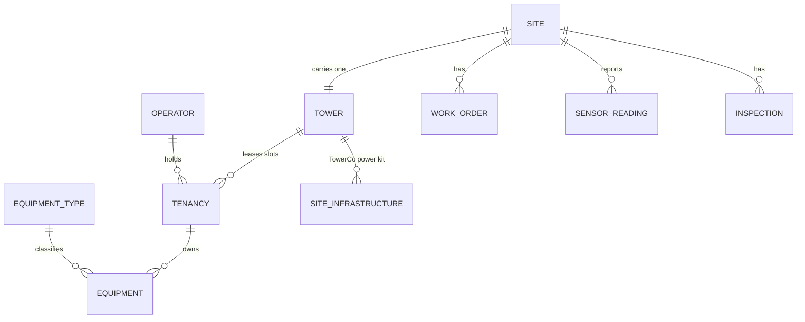
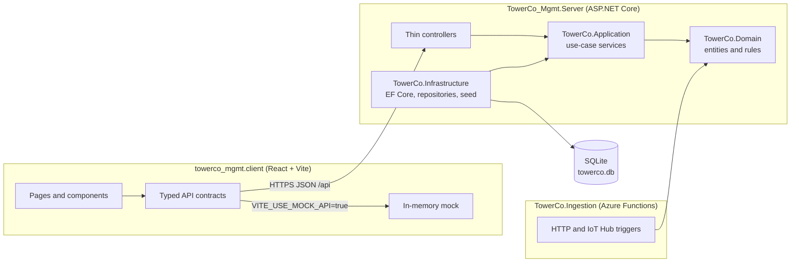
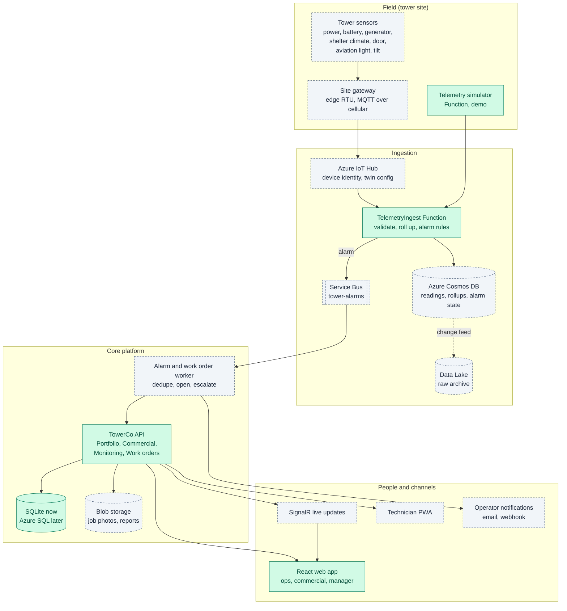
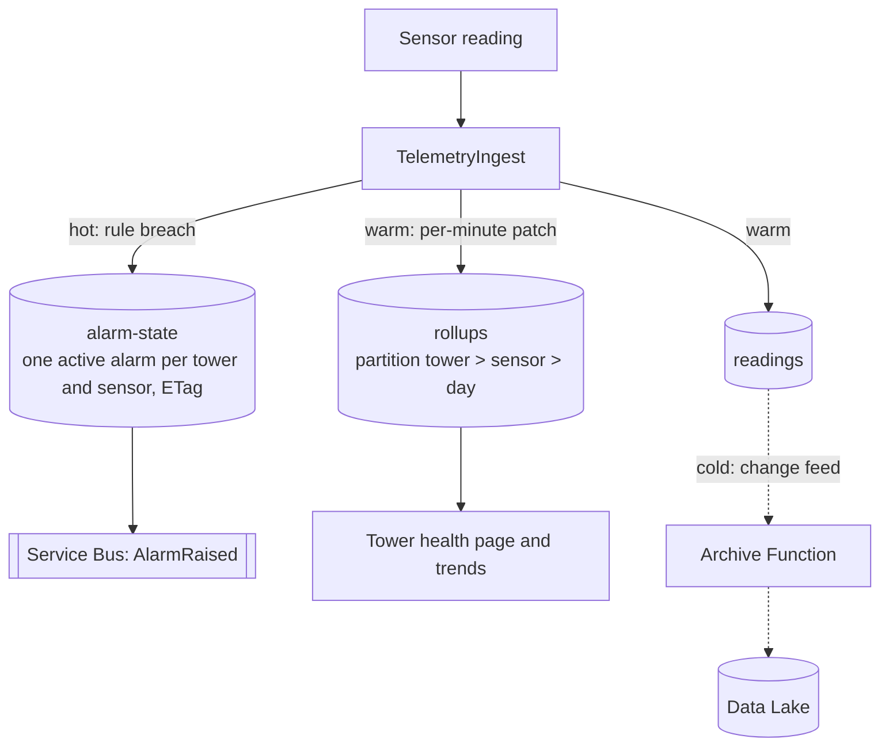
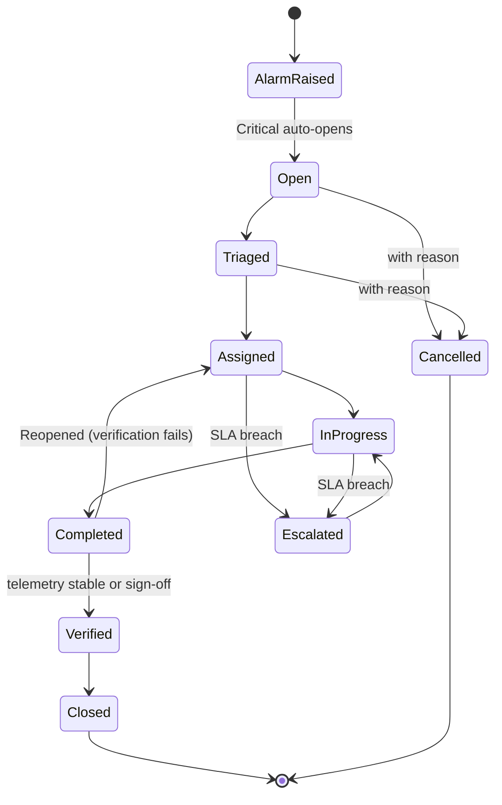
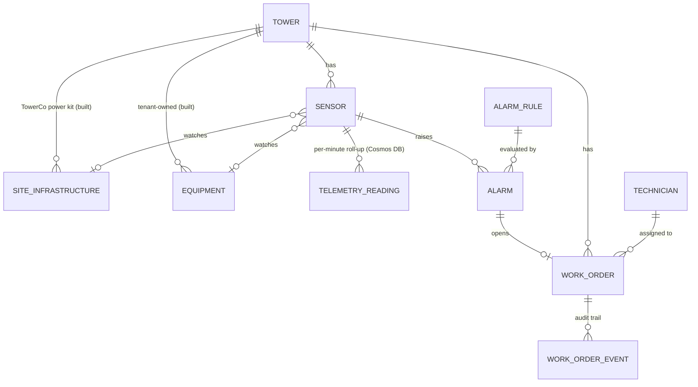
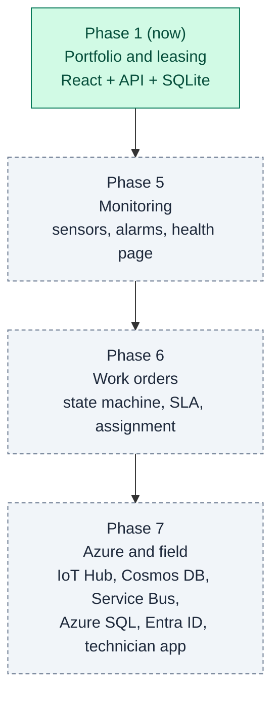

<div align="center">

# 📡 TowerCo Tower Management System

**Lease tower space, track capacity and keep every tower healthy, in one place.**

A demo platform for a telecom tower company that builds towers and leases slots on them to mobile network operators.


https://github.com/user-attachments/assets/5c9f7013-1b38-41ef-910a-1367aa0a3aa7

**▶ Demo video above** ([4K file](https://github.com/prasanna-allu-dev/TowerCo_Mgmt/raw/main/docs/media/2026-11-03_09-29-19_towerco-demo-4k.mp4)) · [Architecture](#-architecture) · [Quick start](#-quick-start) · [Docs](#-documentation)

<sub>All sites, operators and readings are fictional.</sub>

</div>

---

## ✨ At a glance

<table>
<tr>
<td width="33%" valign="top">

### 🏗️ Portfolio
Register sites and towers, move them through their lifecycle (Planned, Under construction, Active, Decommissioned) and search across 4 countries.

</td>
<td width="33%" valign="top">

### 🤝 Leasing
Add operators as tenants with live capacity checks. End, renew and re-price leases; the tower refuses to be oversold, even for future bookings.

</td>
<td width="33%" valign="top">

### 🩺 Operations
Tower health from sensors, inspections and work orders. Work orders follow a strict state machine. Dashboard flags full, empty and at-risk towers.

</td>
</tr>
</table>

## 👥 Who uses it

| Persona | Asks | Answered by |
|---------|------|-------------|
| 🔎 Any user | "Show me everything about this site." | Sites list with filters, site detail |
| 💼 Commercial | "Is there room for another tenant?" | Capacity bar, tenancy actions, tenants register |
| 🛠️ Operations | "How do I register a site and keep it healthy?" | Create site wizard, lifecycle buttons, tower health, work orders |
| 📊 Manager | "How well is the portfolio used?" | Portfolio dashboard: KPIs, utilisation by country, alerts, renewals |

Switch persona from the top bar ("Viewing as"). Personas shape the menu and the actions shown; real sign-in is out of scope for this demo.

## ✅ What works today

| Area | API | UI |
|------|:---:|:--:|
| Sites list, filters and site detail | ✅ | ✅ |
| Register site and tower (3 step wizard) | ✅ | ✅ |
| Site lifecycle and tower capacity changes | ✅ | ✅ |
| End, renew and rent review of tenancies | ✅ | ✅ |
| Add a new tenant | ✅ | 🔜 form not built yet |
| Tenants, equipment and operators registers | ✅ | ✅ |
| TowerCo site infrastructure (generator, battery, solar) | ✅ | ✅ |
| Portfolio dashboard with alerts | ✅ | ✅ |
| Work orders with state machine | ✅ | ✅ |
| Tower health (telemetry, inspections, work orders) | ✅ | ✅ |
| Sensor ingestion (Azure Functions) | 🧪 demo | n/a |
| Sign-in, map view, EF migrations | 🔜 | 🔜 |

## 🧭 Architecture

### Domain model



Capacity is slot based: a tower has `MaxTenants` slots, and the `Tower` aggregate checks every day of a new or renewed lease so it can never be oversold.

### Layers



- **Clean Architecture**: dependencies point inward. Domain has no dependencies; Application defines interfaces; Infrastructure implements them.
- **Rich domain model**: business rules (capacity, duplicate tenancy, active site, work order transitions) live on the entities, not in controllers.
- **Errors as ProblemDetails**: domain exceptions map to HTTP 400, 404 or 409 in one handler.

Full detail: [Backend architecture](docs/architecture/2026-11-02_19-06-37_backend-architecture.md) and [UI architecture](docs/architecture/2026-11-02_19-06-37_ui-architecture.md).

### Target architecture (proposed)

> **Proposed, not approved.** How the system grows from today's sites and tenancies app into a platform that reads tower sensors, raises alarms and runs work orders to closure. Interactive version: [docs/2026-11-02_13-15-06_target-architecture.html](docs/2026-11-02_13-15-06_target-architecture.html). Agreed scope lives in [CLAUDE.md](CLAUDE.md). Sites, operators and readings are fictional.

Legend used below: **built** = in the code today, **proposed** = design only.

<details>
<summary><b>1. System view: from tower sensor to technician and back</b></summary>



Cross-cutting: Entra ID sign-in and roles, Key Vault, Application Insights and Azure Monitor, Bicep and GitHub Actions, Static Web Apps and App Service hosting.

</details>

<details>
<summary><b>2. Telemetry: one reading, three paths</b></summary>



| Path | Purpose |
|------|---------|
| Hot | Alarms. One active alarm per tower and sensor, so a flapping sensor does not open many work orders |
| Warm | Health page and trend charts read per-minute roll-ups; business data stays relational |
| Cold | Every raw reading archived for audit, analytics and replay; Cosmos DB time to live keeps hot storage small |

</details>

<details>
<summary><b>3. Work order lifecycle</b></summary>



Illegal moves raise `InvalidWorkOrderTransitionException` (409). The built six-state machine (Open, Assigned, InProgress, OnHold, Completed, Cancelled) is the first slice of this.

</details>

<details>
<summary><b>4. Domain additions</b></summary>



Notification rule: an alarm on tenant equipment notifies that operator; an alarm on TowerCo site infrastructure that keeps the tower powered or cooled notifies every tenant on the tower.

</details>

<details>
<summary><b>5. Delivery order</b></summary>



Phases 5 and 6 need no Azure services: the simulator calls the API and an in-process queue stands in for Service Bus behind the same interface.

</details>

**Open questions:** per-country data residency; build work orders in-house or integrate an existing maintenance system; auto-open on Critical only or also repeated Warnings.

## 🧰 Tech stack

| Layer | Technology |
|-------|------------|
| API | ASP.NET Core Web API on .NET 10, OpenAPI, Scalar API reference |
| Persistence | Entity Framework Core 10 with SQLite (file database, created and seeded on first run) |
| Ingestion | Azure Functions v4, .NET 10 isolated worker, HTTP and Event Hub (IoT Hub) triggers |
| Client | React 19, React Router 7, TypeScript, Vite 8, oxlint |
| Tests | xUnit, coverlet, `Microsoft.AspNetCore.Mvc.Testing` |

## 📁 Repository layout

```text
TowerCo_Mgmt/
├── TowerCo.Domain/            Entities, value objects, enums, domain exceptions, monitoring rules
├── TowerCo.Application/       Use-case services, DTOs, repository interfaces, options, constants
├── TowerCo.Infrastructure/    EF Core DbContext, entity configurations, repositories, seeders
├── TowerCo_Mgmt.Server/       Controllers, exception handler, DI wiring, appsettings.json
├── TowerCo.Ingestion/         Azure Functions for sensor telemetry (demo)
├── TowerCo.Tests/             xUnit tests for Domain, Application, Infrastructure, Server, Ingestion
├── towerco_mgmt.client/       React single-page application
├── docs/                      Architecture documents, requirements brief, demo deck
├── CLAUDE.md                  Requirements, decisions and progress log
└── TowerCo_Mgmt.slnx          Solution file (all seven projects)
```

## 🚀 Quick start

### Prerequisites

| Tool | Version |
|------|---------|
| .NET SDK | 10.0 |
| Node.js | 24 |
| HTTPS dev certificate | `dotnet dev-certs https --trust` (once per machine) |
| Azure Functions Core Tools | v4 (only to run `TowerCo.Ingestion`) |

### Run the application

The server uses the ASP.NET Core SPA proxy, so starting the API also starts the Vite dev server.

```bash
dotnet run --project TowerCo_Mgmt.Server --launch-profile https
```

Open `https://localhost:57138`. The database is created and seeded on first run.

<details>
<summary><b>More: setup options, ports and database</b></summary>

#### First-time setup (clean clone)

```bash
dotnet dev-certs https --trust
```

```bash
cd towerco_mgmt.client && npm install
```

```bash
dotnet restore TowerCo_Mgmt.slnx
```

Then make sure `towerco_mgmt.client/.env` contains `VITE_USE_MOCK_API=false` so the UI calls the real API (see [Client variables](#client-variables-towerco_mgmtclientenv)).

#### Option A: one command (API and client together)

The `SpaProxy` settings in `TowerCo_Mgmt.Server.csproj` (`SpaRoot`, `SpaProxyLaunchCommand=npm run dev`, `SpaProxyServerUrl`) make the API start the Vite dev server for you. Visual Studio users can press F5 with the `https` profile.

#### Option B: run API and client separately

Terminal 1 (API):

```bash
dotnet run --project TowerCo_Mgmt.Server --launch-profile https
```

Terminal 2 (client):

```bash
cd towerco_mgmt.client && npm run dev
```

The Vite dev server proxies every `/api` call to the API (see `server.proxy` in `vite.config.ts`), so no CORS setup is needed.

#### Option C: client only, on the mock API

Set `VITE_USE_MOCK_API=true` in `towerco_mgmt.client/.env`, then run `npm run dev`. No backend or database is needed; data lives in memory and resets on refresh.

#### Option D: sensor ingestion Functions (optional)

```bash
cd TowerCo.Ingestion && func start
```

Needs Azure Functions Core Tools v4 and a local storage emulator (Azurite) for `AzureWebJobsStorage`. The IoT Hub trigger is disabled locally through `AzureWebJobs.IngestFromIoTHub.Disabled`; use the HTTP endpoint `POST /api/telemetry` instead. Readings are validated and logged only; they are not yet written to the database.

#### URLs and ports

| URL | What | Defined in |
|-----|------|------------|
| `https://localhost:57138` | React client | `vite.config.ts` (`DEV_SERVER_PORT`), `SpaProxyServerUrl` in server `.csproj` |
| `https://localhost:7292` | API (HTTPS) | `TowerCo_Mgmt.Server/Properties/launchSettings.json`, `https` profile |
| `http://localhost:5255` | API (HTTP) | same, `http` and `https` profiles |
| `https://localhost:7292/scalar` | Interactive API reference (Development only) | `Program.cs` |
| `https://localhost:7292/openapi/v1.json` | OpenAPI document | `Program.cs` |

If you change an API port, also update the proxy target (see `ASPNETCORE_HTTPS_PORT` below) so the client still reaches it.

### Database

| Item | Value |
|------|-------|
| Engine | SQLite (single file, no server to install) |
| File location | `TowerCo_Mgmt.Server/towerco.db` when started with `dotnet run` from the repository root or from Visual Studio. The path in the connection string is relative to the API's working directory (the content root) |
| Connection string | `ConnectionStrings:TowerCoDb` in `TowerCo_Mgmt.Server/appsettings.json`, default `Data Source=towerco.db` |
| Created by | API startup: schema via EF Core `EnsureCreated`, then `DatabaseSeeder` fills fictional data if the database is empty |
| Seed content | 12 sites across India, South Africa, Kenya and Nigeria, 9 operators, 8 equipment types, plus tenancies, equipment, work orders, inspections and 30 days of simulated sensor readings |
| Version control | A seeded copy is committed so a clean clone runs at once; delete it to re-seed |
| Tests | Use SQLite in-memory databases, never the file above |

Common tasks:

- **Reset to fresh seed data**: stop the API, delete `TowerCo_Mgmt.Server/towerco.db`, start the API again.
- **After a model or schema change**: same as above. There are no EF migrations yet, so an existing file will not pick up new tables or columns.
- **Use a different file or folder**: change the connection string, for example `Data Source=C:/data/towerco.db`, or override it without editing files with the environment variable `ConnectionStrings__TowerCoDb`.
- **Inspect the data**: open the file with any SQLite browser (for example DB Browser for SQLite or the VS Code SQLite extension). Stop the API first if you plan to edit rows.
- **Missing connection string**: the API fails at startup with `MissingConfigurationException` naming `ConnectionStrings:TowerCoDb`.

</details>

## ⚙️ Configuration

<details>
<summary><b>Server, client and ingestion settings</b></summary>

ASP.NET Core reads `appsettings.json`, then `appsettings.{Environment}.json`, then environment variables. Any key can be overridden with an environment variable by replacing `:` with `__`, for example `Health__TelemetryWindowDays=14`.

### Server variables (`TowerCo_Mgmt.Server/appsettings.json`)

| Key | Default | What it changes |
|-----|---------|-----------------|
| `ConnectionStrings:TowerCoDb` | `Data Source=towerco.db` | SQLite file path (see [Database](#database)) |
| `Dashboard:RenewalWindowDays` | `90` | Tenancies ending within this many days appear as renewals |
| `Dashboard:RenewalCriticalDays` | `30` | Renewals within this many days are flagged critical |
| `Health:TelemetryWindowDays` | `30` | Days of sensor readings used for tower health and sparklines |
| `Health:InspectionWarningMonths` | `12` | Inspection older than this is a warning |
| `Health:InspectionCriticalMonths` | `24` | Inspection older than this is critical |
| `AlarmThresholds:<SensorType>` | see file | `Warning`, `Critical` and `Direction` (`LowIsBad` or `HighIsBad`) for `BatteryVoltage`, `ShelterTemperature`, `GeneratorFuelLevel`, `TowerTilt` |
| `Logging:LogLevel` | `Information` | Log verbosity |

### Launch and environment variables (`launchSettings.json`)

| Variable | Default | What it changes |
|----------|---------|-----------------|
| `ASPNETCORE_ENVIRONMENT` | `Development` | Enables Scalar and OpenAPI; selects `appsettings.Development.json` |
| `applicationUrl` | `https://localhost:7292;http://localhost:5255` | API ports |
| `ASPNETCORE_HOSTINGSTARTUPASSEMBLIES` | `Microsoft.AspNetCore.SpaProxy` | Starts the Vite dev server with the API; remove to run API only |

### Client variables (`towerco_mgmt.client/.env`)

| Variable | Default | What it changes |
|----------|---------|-----------------|
| `VITE_USE_MOCK_API` | unset (real API) | `true` uses in-memory mock data; any other value calls the real API. Set `false` explicitly for demos |
| `VITE_MOCK_LATENCY_MS` | `0` | Artificial delay for mock calls, to show loading states |
| `DEV_SERVER_PORT` | `57138` | Vite dev server port (shell environment variable). Also update `SpaProxyServerUrl` if changed |
| `ASPNETCORE_HTTPS_PORT` / `ASPNETCORE_URLS` | `https://localhost:7292` | Where Vite proxies `/api` (shell environment variable) |

Restart `npm run dev` after editing `.env`; Vite reads it only at start-up.

### Ingestion variables (`TowerCo.Ingestion/local.settings.json`)

| Key | What it changes |
|-----|-----------------|
| `AzureWebJobsStorage` | Functions host storage (standard Functions setting; Azurite locally) |
| `AzureWebJobs.IngestFromIoTHub.Disabled` | `true` locally to switch off the IoT Hub trigger |
| `AlarmThresholds:*` | Same shape as the server section; keep both in step |

Threshold values in configuration are fictional starting values for discussion, not taken from an industry standard. No secrets are stored in this repository: never put a real IoT Hub or storage connection string in `local.settings.json` or `.env`; use user secrets or environment variables instead.

</details>

## 🧪 Testing

```bash
dotnet build TowerCo_Mgmt.slnx
```

```bash
dotnet test TowerCo_Mgmt.slnx
```

```bash
cd towerco_mgmt.client && npm run build && npm run lint
```

Backend tests cover domain rules (capacity, duplicate tenancy, active site, work order transitions, health signals), application services against a seeded SQLite in-memory database, persistence mappings, the exception handler and the ingestion functions. Latest run (3 November 2026): 156 tests, 0 failed. The client has no automated tests yet.

## 📚 Documentation

| Document | Contents |
|----------|----------|
| [Demo video (4K)](docs/media/2026-11-03_09-29-19_towerco-demo-4k.mp4) | Walkthrough of the running app |
| [Backend architecture](docs/architecture/2026-11-02_19-06-37_backend-architecture.md) | Layers, entity model, business rules, API reference, persistence, ingestion |
| [UI architecture](docs/architecture/2026-11-02_19-06-37_ui-architecture.md) | Client structure, routing, data access, mock switch, conventions |
| [Requirements overview](docs/2026-11-02_12-08-38_requirements-overview.html) | Visual requirements brief |
| [Target architecture](docs/2026-11-02_13-15-06_target-architecture.html) | Proposed sensor, alarm and work order platform on Azure |
| [Demo deck](docs/2026-11-02_12-48-28_towerco-demo-deck.html) | Walkthrough slides with speaker notes |
| [CLAUDE.md](CLAUDE.md) | Single source of truth for scope, decisions and progress |

## 🗺️ Roadmap

| Phase | Scope |
|-------|-------|
| 1 | Sites, site detail, register site, portfolio overview, lifecycle and lease actions (current) |
| 2 | Add tenant form, edit tower details, equipment create, edit and remove |
| 3 | Map view coloured by utilisation, drill-down, trends |
| 4 | Role-based views, end tenancy, audit history, Azure App Service and Azure SQL |
| 5 to 8 | Tower health page, alarm-driven work orders, Azure IoT rollout, enterprise integration (all proposed, not approved) |

## 📐 Engineering standards

- Clean Architecture and SOLID; controllers stay thin.
- Custom domain exceptions; no generic exceptions for business failures.
- No hardcoded constants: `Constants/` classes on the backend, `constants/` folders per feature and in `src/shared/` on the client, options in `appsettings.json`.
- Methods kept under 15 lines.
- New backend code targets 100% unit test coverage; build and tests must pass before merge.
- No secrets in code, configuration or documentation.
