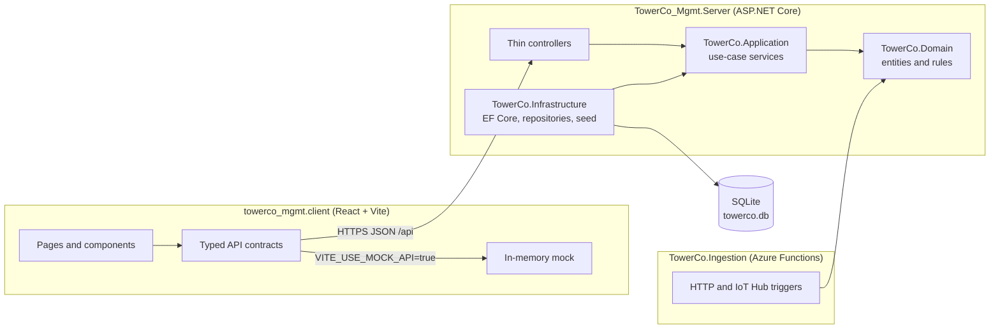

# TowerCo Tower Management System

> Portfolio, tenancy and field operations platform for a telecom tower company that builds towers and leases slots on them to mobile network operators (MNOs).


All data in this repository is **fictional** and exists for demonstration only.

---

## Table of contents

- [Overview](#overview)
- [Use cases](#use-cases)
- [Feature status](#feature-status)
- [Architecture at a glance](#architecture-at-a-glance)
- [Tech stack](#tech-stack)
- [Repository layout](#repository-layout)
- [Getting started](#getting-started)
- [Configuration](#configuration)
- [Testing](#testing)
- [Documentation](#documentation)
- [Roadmap](#roadmap)
- [Engineering standards](#engineering-standards)

---

## Overview

TowerCo operates telecom tower sites across several countries. Each **site** carries one **tower**; each tower has a fixed number of **tenant slots** that are leased to **operators** through **tenancies**. Towers also carry **equipment**, either owned by a tenant (antennas, radios, dishes) or shared TowerCo infrastructure (generators, batteries, solar).

The system answers four everyday questions:

| Persona | Question |
|---------|----------|
| Operations user | Which sites do we have, and how do I register a new one? |
| Commercial user | Does this tower have room for another tenant, and can I add one? |
| Any user | Show me everything about this site. |
| Manager | Where is the portfolio, and how well utilised is it? |

## Use cases

| ID | Persona | Use case |
|----|---------|----------|
| UC1 | Operations | Register a new site and its tower; update details over time |
| UC2 | Commercial | Add an operator as tenant on a tower; see remaining capacity |
| UC3 | Any user | Search and filter sites (country, status, text); open a full site view |
| UC4 | Manager | Portfolio overview: KPIs, utilisation by country, alerts |
| UC5 | Operations / Manager | Tower health from telemetry, inspections and open work orders (proposed) |

## Feature status

| Area | Backend API | UI | Notes |
|------|:-----------:|:--:|-------|
| Sites list and filters (UC3) | Built | Built | Country, status, free text |
| Site detail (UC3) | Built | Built | Site, tower, capacity, tenancies, equipment |
| Register site and tower (UC1) | Built | Built | Three step wizard at `/configuration/new` |
| Add tenant with capacity rules (UC2) | Built | Not yet wired | API client exists (`tenanciesApi`); no form uses it yet |
| Tenancy register | Built | Built | `/tenants` |
| Equipment register and catalogue | Built | Built | `/equipment` |
| Portfolio dashboard (UC4) | Built | Built | KPIs, utilisation, rent, renewals, alerts |
| Work orders | Built | Built | State machine enforced on both sides |
| Tower health (UC5) | Built | Newly added | `/health`; not yet verified in a browser |
| Sensor ingestion (Azure Functions) | Built (demo) | n/a | Alarm publisher is a logging stub |
| Edit site or tower, map view, auth | Planned | Planned | See [Roadmap](#roadmap) |

## Architecture at a glance



- **Clean Architecture**: dependencies point inward. Domain has no dependencies; Application defines interfaces; Infrastructure implements them.
- **Rich domain model**: business rules (capacity, duplicate tenancy, active site, work order transitions) live on the entities, not in controllers.
- **Errors as ProblemDetails**: domain exceptions map to HTTP 400, 404 or 409 in one handler.

Full detail: [Backend architecture](docs/architecture/2026-11-02_19-06-37_backend-architecture.md) and [UI architecture](docs/architecture/2026-11-02_19-06-37_ui-architecture.md).

## Tech stack

| Layer | Technology |
|-------|------------|
| API | ASP.NET Core Web API on .NET 10, OpenAPI, Scalar API reference |
| Persistence | Entity Framework Core 10 with SQLite (file database, created and seeded on first run) |
| Ingestion | Azure Functions v4, .NET 10 isolated worker, HTTP and Event Hub (IoT Hub) triggers |
| Client | React 19, React Router 7, TypeScript, Vite 8, oxlint |
| Tests | xUnit, coverlet, `Microsoft.AspNetCore.Mvc.Testing` |

## Repository layout

```text
TowerCo_Mgmt/
├── TowerCo.Domain/            Entities, value objects, enums, domain exceptions, monitoring rules
├── TowerCo.Application/       Use-case services, DTOs, repository interfaces, options, constants
├── TowerCo.Infrastructure/    EF Core DbContext, entity configurations, repositories, seeders
├── TowerCo_Mgmt.Server/       Controllers, exception handler, DI wiring, appsettings.json
├── TowerCo.Ingestion/         Azure Functions for sensor telemetry (demo)
├── TowerCo.Tests/             xUnit tests for Domain, Application, Infrastructure, Server, Ingestion
├── towerco_mgmt.client/       React single-page application
├── docs/                      Architecture documents, requirements brief, demo deck
├── CLAUDE.md                  Requirements, decisions and progress log
└── TowerCo_Mgmt.slnx          Solution file (all seven projects)
```

## Getting started

### Prerequisites

| Tool | Version |
|------|---------|
| .NET SDK | 10.0 |
| Node.js | 24 |
| HTTPS dev certificate | `dotnet dev-certs https --trust` (once per machine) |
| Azure Functions Core Tools | v4 (only to run `TowerCo.Ingestion`) |

### Run the application

The server uses the ASP.NET Core SPA proxy, so starting the API also starts the Vite dev server.

```bash
dotnet run --project TowerCo_Mgmt.Server --launch-profile https
```

| URL | What |
|-----|------|
| `https://localhost:57138` | React client |
| `https://localhost:7292/scalar` | Interactive API reference (Development only) |
| `https://localhost:7292/openapi/v1.json` | OpenAPI document |

To run the client on its own (for example against the mock API):

```bash
cd towerco_mgmt.client
npm install
npm run dev
```

### Database

- On first start the API creates `TowerCo_Mgmt.Server/towerco.db` and seeds a fictional portfolio: 12 sites across India, South Africa, Kenya and Nigeria, 9 operators and 8 equipment types, plus tenancies, equipment, work orders, inspections and sensor readings.
- The schema is created with `EnsureCreated` (no migrations yet). **After a model change, delete `towerco.db`** and restart to re-seed.

## Configuration

| Setting | Location | Purpose |
|---------|----------|---------|
| `ConnectionStrings:TowerCoDb` | `TowerCo_Mgmt.Server/appsettings.json` | SQLite file path |
| `Dashboard` | same | Renewal window and critical days for dashboard alerts |
| `Health` | same | Telemetry window and inspection age thresholds |
| `AlarmThresholds` | same, and `TowerCo.Ingestion/local.settings.json` | Warning and critical limits per sensor type |
| `VITE_USE_MOCK_API` | `towerco_mgmt.client/.env` | `true` uses the in-memory mock, `false` calls the real API |
| `VITE_MOCK_LATENCY_MS` | `towerco_mgmt.client/.env` | Optional artificial delay for the mock |

Threshold values in configuration are fictional starting values for discussion, not taken from an industry standard. No secrets are stored in this repository.

## Testing

```bash
dotnet build TowerCo_Mgmt.slnx
```

```bash
dotnet test TowerCo_Mgmt.slnx
```

```bash
cd towerco_mgmt.client && npm run build && npm run lint
```

Backend tests cover domain rules (capacity, duplicate tenancy, active site, work order transitions, health signals), application services against a seeded SQLite in-memory database, persistence mappings, the exception handler and the ingestion functions. Latest run (2 November 2026): 108 tests, 0 failed. The client has no automated tests yet.

## Documentation

| Document | Contents |
|----------|----------|
| [Backend architecture](docs/architecture/2026-11-02_19-06-37_backend-architecture.md) | Layers, entity model, business rules, API reference, persistence, ingestion |
| [UI architecture](docs/architecture/2026-11-02_19-06-37_ui-architecture.md) | Client structure, routing, data access, mock switch, conventions |
| [Requirements overview](docs/2026-11-02_12-08-38_requirements-overview.html) | Visual requirements brief |
| [Target architecture](docs/2026-11-02_13-15-06_target-architecture.html) | Proposed sensor, alarm and work order platform on Azure |
| [Demo deck](docs/2026-11-02_12-48-28_towerco-demo-deck.html) | Walkthrough slides with speaker notes |
| [CLAUDE.md](CLAUDE.md) | Single source of truth for scope, decisions and progress |

## Roadmap

| Phase | Scope |
|-------|-------|
| 1 | Sites, site detail, add tenant, register site, portfolio overview (current) |
| 2 | Edit site and tower, status transitions, equipment create, edit and remove |
| 3 | Map view coloured by utilisation, drill-down, trends |
| 4 | Role-based views, end tenancy, audit history, Azure App Service and Azure SQL |
| 5 to 8 | Tower health page, alarm-driven work orders, Azure IoT rollout, enterprise integration (all proposed, not approved) |

## Engineering standards

- Clean Architecture and SOLID; controllers stay thin.
- Custom domain exceptions; no generic exceptions for business failures.
- No hardcoded constants: `Constants/` classes on the backend, `src/constants/` on the client, options in `appsettings.json`.
- Methods kept under 15 lines.
- New backend code targets 100% unit test coverage; build and tests must pass before merge.
- No secrets in code, configuration or documentation.
