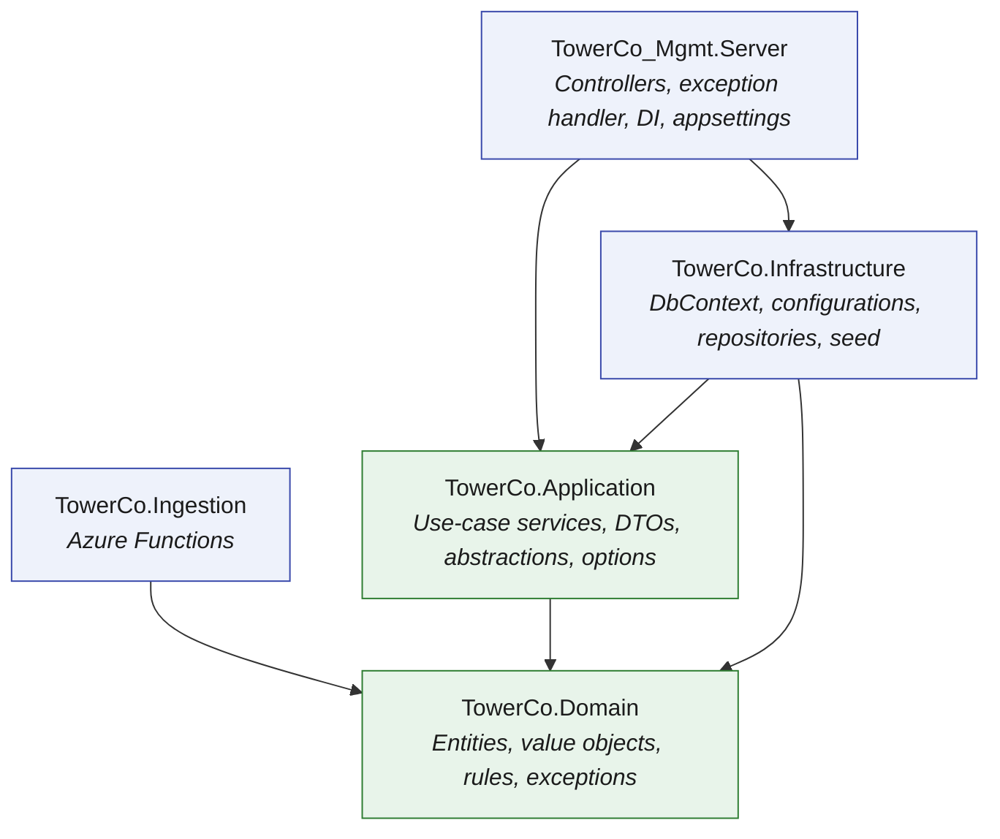
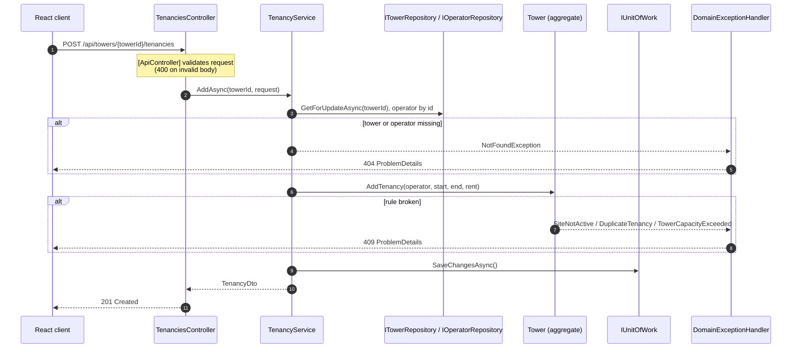
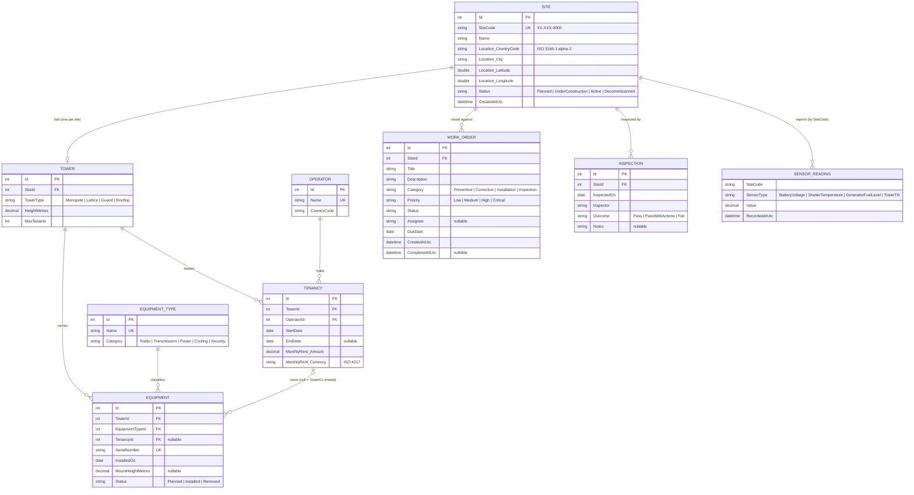
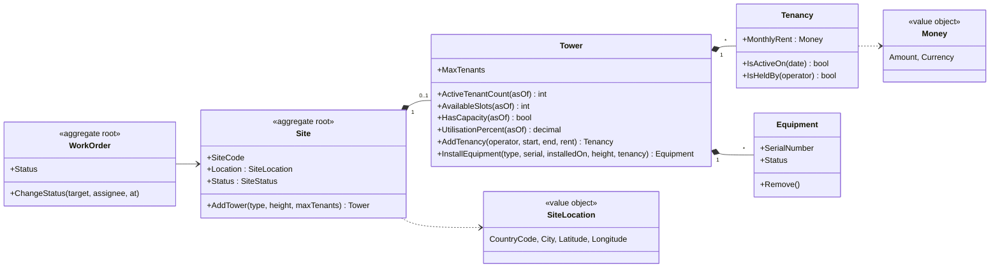
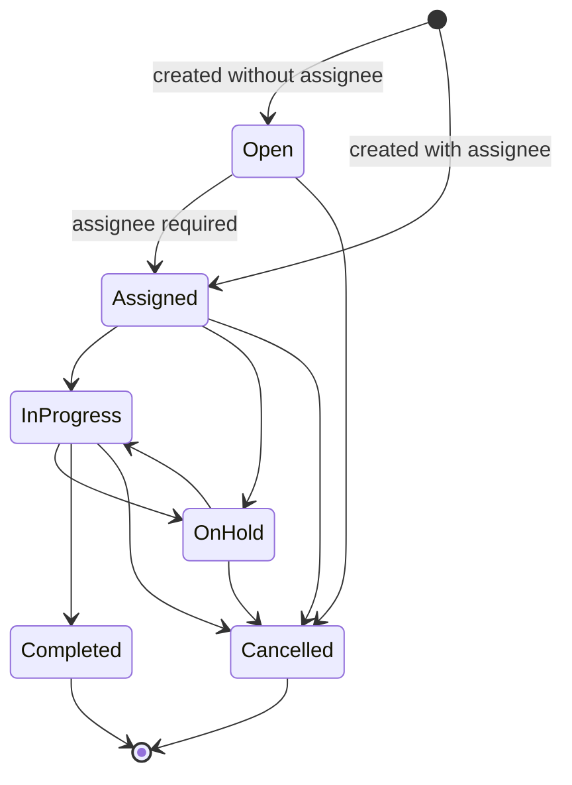
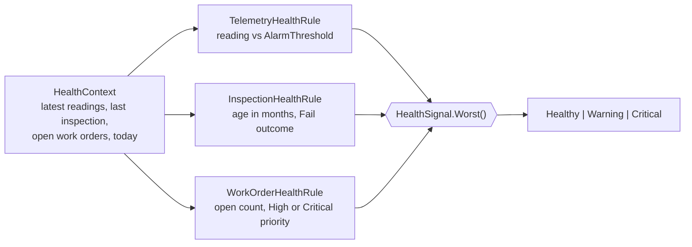
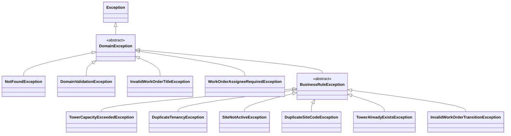
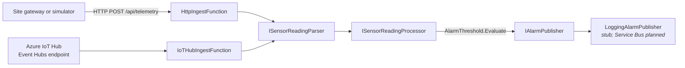
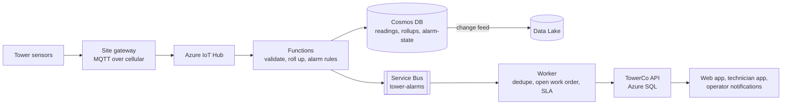

# Backend Architecture

> Entity model and system design for the TowerCo Tower Management API.

| | |
|---|---|
| **Scope** | `TowerCo.Domain`, `TowerCo.Application`, `TowerCo.Infrastructure`, `TowerCo_Mgmt.Server`, `TowerCo.Ingestion`, `TowerCo.Tests` |
| **Runtime** | .NET 10, ASP.NET Core Web API, EF Core 10, SQLite |
| **Status** | Phase 1 built; target architecture sections marked *Proposed* are not approved |
| **Related** | [README](../../README.md), [UI architecture](2026-11-02_19-06-37_ui-architecture.md) |

---

## Contents

1. [Design goals](#1-design-goals)
2. [Solution structure](#2-solution-structure)
3. [Request lifecycle](#3-request-lifecycle)
4. [Domain model](#4-domain-model)
5. [Business rules](#5-business-rules)
6. [Work order lifecycle](#6-work-order-lifecycle)
7. [Tower health evaluation](#7-tower-health-evaluation)
8. [API reference](#8-api-reference)
9. [Error handling](#9-error-handling)
10. [Persistence](#10-persistence)
11. [Configuration](#11-configuration)
12. [Sensor ingestion](#12-sensor-ingestion)
13. [Testing strategy](#13-testing-strategy)
14. [Target architecture (proposed)](#14-target-architecture-proposed)
15. [Known gaps and decisions](#15-known-gaps-and-decisions)

---

## 1. Design goals

| Goal | How it is met |
|------|---------------|
| Explainable | Small set of entities; capacity is derived, never stored |
| Rules in one place | Invariants live on aggregates (`Tower`, `Site`, `WorkOrder`), not in controllers |
| Swappable infrastructure | Application depends on repository interfaces; SQLite can be replaced by Azure SQL through the connection string |
| Changeable | Thin controllers, one service per use case, constants and options instead of literals |
| Testable | Domain has no framework dependencies; services run against SQLite in-memory in tests |

## 2. Solution structure



**Dependency rule:** arrows point inward. `TowerCo.Domain` references nothing. `TowerCo.Application` owns the interfaces (`ITowerRepository`, `IUnitOfWork`, ...) that `TowerCo.Infrastructure` implements.

| Project | Responsibility | Key folders |
|---------|----------------|-------------|
| `TowerCo.Domain` | Entities and their invariants, value objects, enums, domain exceptions, monitoring rules | `Entities/`, `ValueObjects/`, `Enums/`, `Exceptions/`, `Monitoring/`, `Common/` |
| `TowerCo.Application` | One service per use case behind an interface; DTOs; request validation attributes; options classes | `Sites/`, `Tenancies/`, `Tenants/`, `Towers/`, `Operators/`, `EquipmentRegister/`, `Dashboard/`, `WorkOrders/`, `Health/`, `Abstractions/`, `Constants/` |
| `TowerCo.Infrastructure` | EF Core `TowerCoDbContext`, one `IEntityTypeConfiguration` per entity, repositories, unit of work, seeders | `Persistence/Configurations/`, `Persistence/Repositories/`, `Persistence/Seed/` |
| `TowerCo_Mgmt.Server` | HTTP surface: thin controllers, `DomainExceptionHandler`, OpenAPI and Scalar, SPA hosting | `Controllers/`, `ExceptionHandling/`, `ApiRoutes.cs` |
| `TowerCo.Ingestion` | Sensor telemetry intake: parse, evaluate thresholds, publish alarms | `Functions/`, `Processing/`, `Contracts/` |
| `TowerCo.Tests` | xUnit tests across all layers | `Domain/`, `Application/`, `Infrastructure/`, `Server/`, `Ingestion/` |

### Composition root

`Program.cs` wires everything in two calls plus options:

```csharp
builder.Services.AddApplication();                         // use-case services, health rules, TimeProvider
builder.Services.AddInfrastructure(builder.Configuration); // DbContext, repositories, unit of work
builder.Services.AddOptions<DashboardOptions>().BindConfiguration(ConfigurationSections.Dashboard)
    .ValidateDataAnnotations().ValidateOnStart();
```

Options are validated at start-up, so a missing or invalid setting fails fast instead of at first request.

## 3. Request lifecycle

Example: commercial user adds an operator as tenant (UC2).



Controllers contain no logic beyond delegating to a service and shaping the HTTP result.

## 4. Domain model

### 4.1 Entity relationship diagram



### 4.2 Aggregates and ownership



- `Tower`, `Tenancy` and `Equipment` constructors are `internal`: they can only be created through `Site.AddTower`, `Tower.AddTenancy` and `Tower.InstallEquipment`. This guarantees every rule runs.
- All setters are private. State changes only through intention-revealing methods.
- `Operator`, `EquipmentType` and `WorkOrder` are independent entities with public constructors.

### 4.3 Entity catalogue

| Entity | Purpose | Notes |
|--------|---------|-------|
| `Site` | Physical location TowerCo operates | Aggregate root for its tower. `SiteCode` unique. One tower per site (simplification) |
| `Tower` | Structure on a site | Slot-based capacity: `MaxTenants` operators at a time |
| `Operator` | Mobile network operator (fictional) | Name unique |
| `Tenancy` | Lease of one slot by an operator | Active when `EndDate` is null or on or after the given date |
| `EquipmentType` | Configurable catalogue | New types are data, not code |
| `Equipment` | Physical asset on a tower | `TenancyId` set means tenant-owned; null means TowerCo shared infrastructure |
| `WorkOrder` | Field job raised against a site | Status workflow enforced in the entity |
| `Inspection` | Structural inspection record | Feeds tower health |
| `SensorReading` | One normalised telemetry measurement | Keyed by `SiteCode`; feeds tower health |

### 4.4 Derived values (not stored)

| Value | Formula | Lives on |
|-------|---------|----------|
| `ActiveTenantCount` | tenancies where `IsActiveOn(asOf)` | `Tower` |
| `AvailableSlots` | `max(0, MaxTenants - ActiveTenantCount)` | `Tower` |
| `HasCapacity` | `AvailableSlots > 0` | `Tower` |
| `UtilisationPercent` | `ActiveTenantCount / MaxTenants x 100`, one decimal | `Tower` |

Every capacity method takes an `asOf` date. Services pass today's date from an injected `TimeProvider`, which keeps the logic deterministic in tests.

**Why slot-based capacity:** simple, explainable and matches the question "is there room for another tenant?". Real-world capacity also depends on structural load (antenna weight, wind load); that is a future extension.

## 5. Business rules

| # | Rule | Enforced in | Exception | HTTP |
|---|------|-------------|-----------|------|
| 1 | Tenant added only when tower has a free slot on the start date | `Tower.EnsureCanLease` | `TowerCapacityExceededException` | 409 |
| 2 | Operator cannot hold two active tenancies on one tower | `Tower.EnsureCanLease` | `DuplicateTenancyException` | 409 |
| 3 | Tenants added only to `Active` sites | `Tower.EnsureCanLease` | `SiteNotActiveException` | 409 |
| 4 | Unknown site, tower or operator | Application services | `NotFoundException` | 404 |
| 5 | `SiteCode` must be unique | `SiteCommandService` | `DuplicateSiteCodeException` | 409 |
| 6 | Height and max tenants must be positive | `Guard` in `Tower` constructor; request limits in `ValidationRules` | `DomainValidationException` | 400 |
| 7 | New site starts as `Planned` | `SiteCommandService` | n/a | n/a |
| 8 | A site has at most one tower | `Site.AddTower` | `TowerAlreadyExistsException` | 409 |
| 9 | Tenancy end date not before start; rent positive | `Guard` in `Tenancy` constructor | `DomainValidationException` | 400 |
| 10 | Work order moves only along allowed transitions | `WorkOrder.ChangeStatus` | `InvalidWorkOrderTransitionException` | 409 |
| 11 | `Assigned` status needs an assignee | `WorkOrder.ChangeStatus` | `WorkOrderAssigneeRequiredException` | 400 |
| 12 | Work order title at least 5 characters | `WorkOrder` constructor | `InvalidWorkOrderTitleException` | 400 |

Request-shape validation (country code pattern, site code pattern `^[A-Z]{2}-[A-Z]{3}-\d{4}$`, tower height 5 to 120 m, 1 to 6 tenant slots, currency pattern) uses data annotations with limits from `TowerCo.Application/Constants/ValidationRules.cs`, and returns 400 through `[ApiController]`.

## 6. Work order lifecycle



- Transition table is a single static dictionary in `WorkOrder.AllowedTransitions`. The client mirrors it in `src/constants/workOrders.ts` to enable only valid buttons; the server remains the authority.
- `CompletedAtUtc` is stamped on entry to `Completed`.

## 7. Tower health evaluation

Health is computed per site from three independent signals. Each rule implements `IHealthSignalRule`, so adding a signal means adding a class (Open/Closed principle).



| Signal | Warning | Critical | Source of limits |
|--------|---------|----------|------------------|
| Telemetry | any reading at or past warning limit | any reading at or past critical limit | `AlarmThresholds` config |
| Inspection | none on record, or older than `InspectionWarningMonths` | outcome `Fail`, or older than `InspectionCriticalMonths` | `Health` config |
| Work orders | one or more open | any open with priority `High` or `Critical` | rule logic |

Overall status is the worst signal. `AlarmThreshold.Evaluate` supports both directions (`HighIsBad`, `LowIsBad`). Threshold values are fictional discussion values.

## 8. API reference

Base path `/api`. JSON with string enums. Interactive reference at `/scalar` in Development.

| Method | Route | Use case | Success | Errors |
|--------|-------|----------|---------|--------|
| GET | `/sites?country=&status=&search=` | UC3 list and filter | 200 `SiteSummaryDto[]` | 400 |
| GET | `/sites/{id}` | UC3 full site view | 200 `SiteDetailDto` | 404 |
| POST | `/sites` | UC1 register site and tower | 201 `SiteDetailDto` | 400, 409 |
| GET | `/operators` | Tenant picker | 200 `OperatorDto[]` | |
| GET | `/towers` | Tower configuration list | 200 `TowerConfigurationDto[]` | |
| GET | `/tenancies` | Tenancy register (filters: search, operatorId, state, country) | 200 `TenantRecordDto[]` | 400 |
| POST | `/towers/{towerId}/tenancies` | UC2 add tenant | 201 `TenancyDto` | 400, 404, 409 |
| GET | `/equipment` | Equipment register (filters: search, category, owner, status, country, siteId) | 200 `EquipmentItemDto[]` | 400 |
| GET | `/equipment-types` | Catalogue with item counts | 200 `EquipmentTypeSummaryDto[]` | |
| GET | `/dashboard` | UC4 portfolio overview | 200 `PortfolioDashboardDto` | |
| GET | `/work-orders?search=&status=&priority=&country=` | Work order list | 200 `WorkOrderDto[]` | 400 |
| GET | `/work-orders/{id}` | Work order detail | 200 `WorkOrderDto` | 404 |
| POST | `/work-orders` | Raise work order | 201 `WorkOrderDto` | 400, 404 |
| PATCH | `/work-orders/{id}/status` | Change status | 200 `WorkOrderDto` | 400, 404, 409 |
| GET | `/health/sites?country=&status=` | UC5 portfolio health | 200 `PortfolioHealthDto` | 400 |
| GET | `/health/sites/{siteId}` | UC5 site health detail | 200 `SiteHealthDto` | 404 |

Route templates are centralised in `TowerCo_Mgmt.Server/ApiRoutes.cs`.

### Key payloads

```jsonc
// SiteSummaryDto
{
  "id": 2, "siteCode": "IN-DEL-0002", "name": "...", "countryCode": "IN", "city": "...",
  "status": "Active", "towerId": 2,
  "capacity": { "maxTenants": 3, "activeTenantCount": 2, "availableSlots": 1,
                "utilisationPercent": 66.7, "hasCapacity": true }
}

// CreateTenancyRequest  (POST /api/towers/{towerId}/tenancies)
{ "operatorId": 3, "startDate": "2026-11-02", "monthlyRent": 45000, "currency": "INR" }

// UpdateWorkOrderStatusRequest  (PATCH /api/work-orders/{id}/status)
{ "status": "Assigned", "assignee": "..." }
```

The `SiteSummaryDto` above illustrates shape only; use the Scalar reference for live values.

## 9. Error handling



`DomainExceptionHandler` (an `IExceptionHandler`) maps the hierarchy to RFC 7807 ProblemDetails:

| Exception type | HTTP status |
|----------------|-------------|
| `NotFoundException` | 404 Not Found |
| any `BusinessRuleException` | 409 Conflict |
| any other `DomainException` | 400 Bad Request |
| non-domain exception | not handled; default 500 |

A new rule only needs a new exception class deriving from the right base; no handler change is required.

## 10. Persistence

| Aspect | Choice |
|--------|--------|
| Provider | EF Core 10 with SQLite (`Data Source=towerco.db`) |
| Schema creation | `Database.EnsureCreatedAsync()` at start-up; no migrations yet |
| Mapping | One `IEntityTypeConfiguration<T>` per entity, applied with `ApplyConfigurationsFromAssembly` |
| Enums | Stored as text (`HasConversion<string>()`) for readable data |
| Value objects | `SiteLocation` and `Money` mapped as EF Core complex properties (columns inline on the owning table) |
| Unique indexes | `Site.SiteCode`, `Operator.Name`, `EquipmentType.Name`, `Equipment.SerialNumber` |
| Query indexes | `WorkOrder (SiteId, Status)`, `SensorReading (SiteCode, RecordedAtUtc)` |
| `SensorReading` key | Shadow key (the domain record has no identity) |
| Unit of work | `IUnitOfWork.SaveChangesAsync` wraps `DbContext.SaveChangesAsync` |
| Read vs update | `ITowerRepository.GetBySiteIdAsync` is read only; `GetForUpdateAsync` returns a tracked aggregate |

### Seed data

`DatabaseSeeder`, `WorkOrderSeeder` and `HealthSeeder` run on start-up and skip when data already exists. Source data lives in `SeedCatalogue` (data only) and is turned into entities through the domain methods, so seed data obeys the same rules as user input.

| Item | Seeded |
|------|--------|
| Sites and towers | 12 (IN 4, KE 3, ZA 3, NG 2), mixed statuses |
| Operators | 9 fictional MNOs |
| Equipment types | 8 (5G AAU, 4G RRU, Microwave Dish, Diesel Generator, Battery Bank, Solar Array, Air Conditioner, Security Camera) |
| Tenancies | Mix of full, partial and empty towers |
| Equipment | Per tenancy: radio plus microwave dish; per active tower: shared power plus battery |
| Work orders, inspections, sensor readings | Planted mix of healthy, warning and critical sites |

## 11. Configuration

All tunable values live in `TowerCo_Mgmt.Server/appsettings.json` and are bound to validated options classes.

| Section | Options class | Keys |
|---------|---------------|------|
| `ConnectionStrings` | n/a | `TowerCoDb` (missing value raises `MissingConfigurationException`) |
| `Dashboard` | `DashboardOptions` | `RenewalWindowDays`, `RenewalCriticalDays` |
| `Health` | `HealthOptions` | `TelemetryWindowDays`, `InspectionWarningMonths`, `InspectionCriticalMonths` |
| `AlarmThresholds` | `SensorThresholdOptions` | One entry per `SensorType`: `Warning`, `Critical`, `Direction` (start-up fails if any type is missing) |

Code constants live in `TowerCo.Application/Constants/` (`ValidationRules`, `FilterValues`, `DisplayLabels`, `AlertMessages`, `ConfigurationSections`), `TowerCo.Domain/Common/DomainConstants.cs` and `TowerCo.Infrastructure/InfrastructureConstants.cs`.

## 12. Sensor ingestion

`TowerCo.Ingestion` is an Azure Functions v4 project (.NET 10 isolated worker) that reuses domain monitoring types.



- Both triggers share one processor. Bad HTTP bodies return 400 ProblemDetails; bad IoT Hub messages are logged and skipped so one bad message never blocks a batch.
- Custom exceptions: `InvalidSensorPayloadException`, `MissingAlarmThresholdException`.
- The IoT Hub trigger is disabled locally through `AzureWebJobs.IngestFromIoTHub.Disabled`.
- Readings are not yet persisted by the function; the API's health data comes from seeded `SensorReading` rows.

## 13. Testing strategy

| Area | Folder | Focus |
|------|--------|-------|
| Domain | `TowerCo.Tests/Domain` | Capacity maths, tenancy rules 1 to 3, guards, work order transitions, alarm thresholds, health worst-of |
| Application | `TowerCo.Tests/Application` | Services against seeded SQLite in-memory: filtering, site creation, add tenant, registers, health rules, request validation |
| Infrastructure | `TowerCo.Tests/Infrastructure` | EF mappings round-trip, DI registration, missing configuration |
| Server | `TowerCo.Tests/Server` | Exception to status code mapping |
| Ingestion | `TowerCo.Tests/Ingestion` | Parser, processor, function behaviour with fakes |

Latest run (2 November 2026): **108 tests, 0 failed**.

```bash
dotnet test TowerCo_Mgmt.slnx --collect:"XPlat Code Coverage"
```

## 14. Target architecture (proposed)

> Draft for discussion, not approved. Full visual: [target architecture](../2026-11-02_13-15-06_target-architecture.html).



- Business data stays relational (SQLite now, Azure SQL later); telemetry moves to Azure Cosmos DB.
- Modular monolith: `Monitoring/` and `WorkOrders/` folders in existing projects; ingestion deploys separately.
- Open questions: per-country data residency, build versus integrate work orders, auto-open on Critical only or also on repeated Warnings.

## 15. Known gaps and decisions

| Item | Status | Note |
|------|--------|------|
| No authentication or roles | Accepted for Phase 1 | Personas are conceptual; Entra ID planned in Phase 4 |
| `EnsureCreated` instead of migrations | Accepted for demo | Delete `towerco.db` after model changes; add migrations before any shared environment |
| `HealthController` route literal | Tech debt | Uses `"api/health/sites"` directly; move into `ApiRoutes` for consistency |
| Edit site or tower, end tenancy | Planned | Phase 2 and Phase 4 |
| Load-based capacity | Future | Weight and wind load per equipment type |
| Alarm publisher | Stub | Logs only; Service Bus publisher planned |
| Pagination | Not implemented | Portfolio is small; add before scale |
