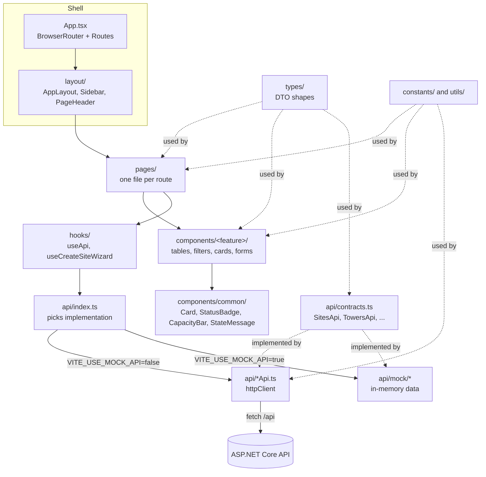
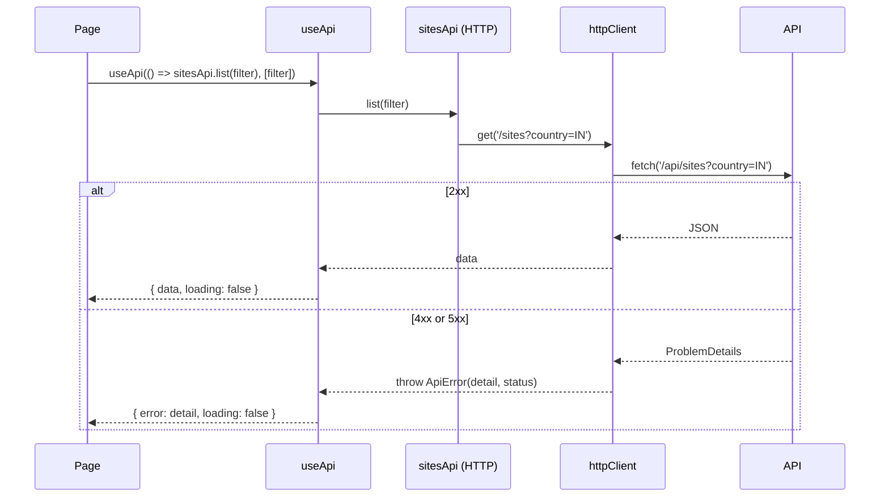
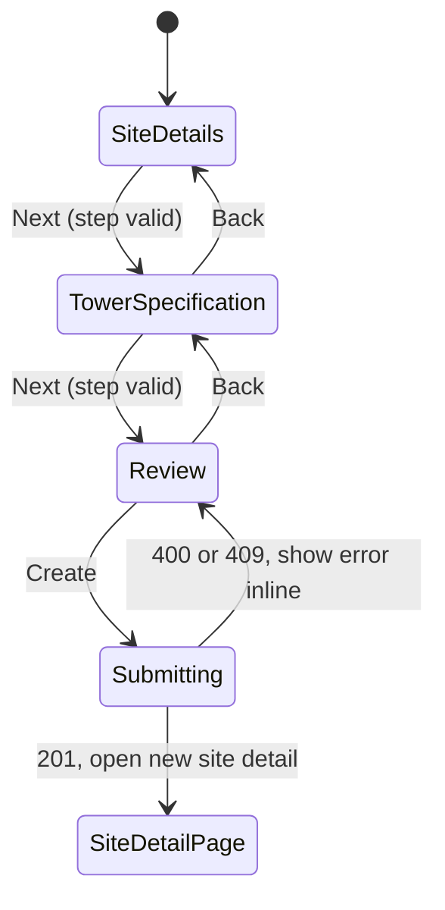
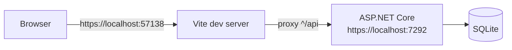

# UI Architecture

> Structure, data flow and conventions for the TowerCo React client (`towerco_mgmt.client`).

| | |
|---|---|
| **Stack** | React 19, React Router 7, TypeScript, Vite 8, oxlint |
| **Hosting** | Vite dev server behind the ASP.NET Core SPA proxy; built assets served by `TowerCo_Mgmt.Server` |
| **Status** | Phase 1 screens built; tower health page newly added |
| **Related** | [README](../../README.md), [Backend architecture](2026-11-02_19-06-37_backend-architecture.md) |

---

## Contents

1. [Design goals](#1-design-goals)
2. [Layered structure](#2-layered-structure)
3. [Folder layout](#3-folder-layout)
4. [Screens and routing](#4-screens-and-routing)
5. [Data access](#5-data-access)
6. [State management](#6-state-management)
7. [Key flows](#7-key-flows)
8. [Domain logic on the client](#8-domain-logic-on-the-client)
9. [Error handling and feedback](#9-error-handling-and-feedback)
10. [Styling](#10-styling)
11. [Build, tooling and local development](#11-build-tooling-and-local-development)
12. [Conventions and how to extend](#12-conventions-and-how-to-extend)
13. [Known gaps](#13-known-gaps)

---

## 1. Design goals

| Goal | How it is met |
|------|---------------|
| Build UI before the API exists | Every resource has a typed contract with two implementations: HTTP and in-memory mock |
| Server is the authority | Client validation improves feedback; business rules are enforced again by the API |
| Small, predictable files | Pages compose feature components; components stay presentational |
| No magic values | Routes, endpoints, limits, labels and thresholds live in `src/constants/` |
| Minimal dependencies | Only `react`, `react-dom` and `react-router-dom` at runtime |

## 2. Layered structure



Dependency direction is top to bottom. Components never call `fetch`; pages never know whether data is mocked.

## 3. Folder layout

```text
towerco_mgmt.client/src/
├── App.tsx                 Route table
├── main.tsx                React root (StrictMode)
├── layout/                 AppLayout (shell + <Outlet/>), Sidebar (NAV_GROUPS), PageHeader
├── pages/                  Route-level screens, compose components and call hooks
├── components/
│   ├── common/             Card, StatusBadge, CapacityBar, StateMessage
│   ├── sites/              SiteFilters, SitesTable, SiteInfoCard, TowerCapacityCard, TenanciesTable
│   ├── configuration/      Create site wizard: steps, form model, validators
│   ├── dashboard/          KpiRow, KpiTile, BarList, RentList, AlertsPanel, tables, SeverityPill
│   ├── tenants/            TenantFilters, TenantKpis, TenantsTable
│   ├── equipment/          EquipmentFilters, EquipmentTable, EquipmentTypesTable, SiteEquipmentCard
│   ├── workOrders/         Filters, KPIs, table, pills, create form, status actions
│   └── health/             HealthFilters, HealthKpis, HealthTable, HealthPill, SiteHealthCard, Sparkline
├── hooks/                  useApi (generic fetch state), useCreateSiteWizard (wizard state machine)
├── api/
│   ├── contracts.ts        Interfaces per resource
│   ├── index.ts            Chooses HTTP or mock per resource
│   ├── httpClient.ts       fetch wrapper: JSON, ProblemDetails to ApiError
│   ├── ApiError.ts         Error with HTTP status
│   ├── *Api.ts             HTTP implementations
│   └── mock/               In-memory implementations and fictional data
├── types/                  TypeScript shapes mirroring backend DTOs
├── constants/              api, navigation, domain, workOrders
└── utils/                  format, severity, workOrder helpers
```

Each component folder exposes an `index.ts` barrel so pages import from `@/components/<feature>`. The `@` alias maps to `src/` (see `vite.config.ts`).

## 4. Screens and routing

All routes render inside `AppLayout`, which provides the sidebar and page frame. Unknown paths redirect to `/sites`.

| Route | Page | Use case | What it shows |
|-------|------|----------|---------------|
| `/dashboard` | `DashboardPage` | UC4 | KPI tiles, utilisation by country, sites by status, tenancies by operator, monthly rent per currency, renewals due, sellable towers, critical indicators |
| `/sites` | `SitesPage` | UC3 | Filters (country, status, text) and sites table with tenants `x/y` and capacity badge |
| `/sites/:siteId` | `SiteDetailPage` | UC3 | Site info, tower capacity bar, tenancies, equipment split into tenant-owned and TowerCo shared |
| `/configuration` | `ConfigurationPage` | UC1 | Tower configuration list and "New tower site" entry point |
| `/configuration/new` | `CreateTowerSitePage` | UC1 | Three step wizard: site details, tower specification, review and create |
| `/equipment` | `EquipmentPage` | Register | Equipment register with filters and type catalogue |
| `/tenants` | `TenantsPage` | UC2 | Tenancy register with KPIs and filters (operator, country, state) |
| `/operators` | `OperatorsPage` | UC2 | Operator list |
| `/work-orders` | `WorkOrdersPage` | Operations | KPIs (open, overdue, due this week, unassigned), filters, create form, table |
| `/work-orders/:workOrderId` | `WorkOrderDetailPage` | Operations | Detail with status actions driven by the state machine |
| `/health` | `HealthPage` | UC5 | Portfolio health KPIs, filters (country, status), sites table with status pill, site health card with sensor sparklines (newest screen; not yet verified in a browser) |

### Navigation

`Sidebar` renders `NAV_GROUPS` from `src/constants/navigation.ts`:

| Group | Items |
|-------|-------|
| Overview | Dashboard |
| Portfolio | Sites, Configuration, Equipment |
| Commercial | Tenants, Operators |
| Operations | Work orders, Tower health |

Route paths live in `ROUTES`; helpers such as `workOrderPath(id)` build links, so no page hardcodes a URL.

## 5. Data access

### 5.1 Contracts and implementation switch

```ts
// api/contracts.ts
export interface SitesApi {
    list: (filter?: SiteFilter) => Promise<SiteSummary[]>;
    get: (id: number) => Promise<SiteDetail>;
    create: (request: CreateSiteRequest) => Promise<SiteDetail>;
}

// api/index.ts
export const sitesApi = USE_MOCK_API ? mockSitesApi : httpSitesApi;
```

| Contract | HTTP endpoints | Mock |
|----------|----------------|------|
| `SitesApi` | `GET /sites`, `GET /sites/{id}`, `POST /sites` | Yes |
| `OperatorsApi` | `GET /operators` | Yes |
| `TowersApi` | `GET /towers` | Yes |
| `TenantsApi` | `GET /tenancies` | Yes |
| `EquipmentApi` | `GET /equipment`, `GET /equipment-types` | Yes |
| `DashboardApi` | `GET /dashboard` | Yes |
| `WorkOrdersApi` | `GET`, `POST /work-orders`, `GET /work-orders/{id}`, `PATCH /work-orders/{id}/status` | Yes |
| `HealthApi` | `GET /health/sites`, `GET /health/sites/{siteId}` | No (telemetry exists only in the backend) |
| `tenanciesApi` | `POST /towers/{towerId}/tenancies` | No |

`USE_MOCK_API` reads `import.meta.env.VITE_USE_MOCK_API === 'true'`. Anything else, including an unset value, uses the real API. Mocks honour the same status codes as the server (404, 409, 400) so error UI can be exercised without a backend. `VITE_MOCK_LATENCY_MS` adds artificial delay to show loading states.

### 5.2 HTTP client



- `httpClient` exposes `get`, `post` and `patch`, always sends JSON and prefixes `API_BASE_URL` (`/api`).
- Non-2xx responses are converted to `ApiError` using ProblemDetails `detail`, then `title`, then `API_ERROR_FALLBACK`.
- Endpoints are built only from `API_ENDPOINTS` in `src/constants/api.ts`, which mirrors `ApiRoutes.cs` on the server.

### 5.3 Types

`src/types/` holds one file per resource (`site.ts`, `tenancy.ts`, `workOrder.ts`, ...) mirroring backend DTOs. Enum values are string unions that match the server's `JsonStringEnumConverter` output, for example `SiteStatus = 'Planned' | 'UnderConstruction' | 'Active' | 'Decommissioned'`.

## 6. State management

| Kind of state | Where it lives |
|---------------|----------------|
| Server data | `useApi(fetcher, deps)` per page: `{ data, error, loading, reload }` |
| Filters | Local `useState` in the page, passed to the fetcher as dependencies |
| Multi-step form | Dedicated hook (`useCreateSiteWizard`) holding values, errors, step and submit state |
| Small form | Colocated hook (`useCreateWorkOrderForm`) |
| Navigation | React Router (`useParams`, `useNavigate`) |

There is no global store. Data is fetched per screen and refreshed with `reload()` after a mutation. This keeps the client simple for the current scale; a cache library (for example TanStack Query) is a sensible next step if screens start sharing data.

## 7. Key flows

### 7.1 Register a site and tower (UC1)



- `STEP_VALIDATORS` validate each step: site code format `XX-XXX-0000`, latitude and longitude ranges, tower height 5 to 120 m, 1 to 6 tenant slots. Limits come from `TOWER_LIMITS`, `SITE_CODE_PATTERN`, `LATITUDE_LIMIT` and `LONGITUDE_LIMIT` in `constants/domain.ts`, matching `ValidationRules` on the server.
- A duplicate site code returns 409 from the API and is shown on the review step.

### 7.2 Work order status change

`WorkOrderStatusActions` renders only the transitions allowed by `WORK_ORDER_TRANSITIONS` for the current status. Choosing `Assigned` requires an engineer. The API re-checks both rules and returns 409 or 400 if the client is bypassed.

## 8. Domain logic on the client

Client-side logic is limited to presentation and early feedback. Each item has a server counterpart that stays authoritative.

| Concern | Client location | Server counterpart |
|---------|-----------------|--------------------|
| Work order transitions | `constants/workOrders.ts` `WORK_ORDER_TRANSITIONS` | `WorkOrder.AllowedTransitions` |
| Site code and tower limits | `constants/domain.ts` | `ValidationRules` |
| Utilisation severity (75% warning, 100% critical) | `utils/severity.ts` | n/a (display only) |
| Renewal severity (30 days critical, 90 days warning) | `utils/severity.ts`, `constants/domain.ts` | `Dashboard` options |
| Site status colour | `utils/severity.ts` `STATUS_SEVERITY` | n/a |

### Severity scale

One shared `Severity` type drives badges, pills and KPI tiles across screens:

| Severity | Label | Meaning |
|----------|-------|---------|
| `ok` | Healthy | Within limits |
| `warning` | Warning | Approaching a limit |
| `critical` | Critical | Limit reached or breached |
| `neutral` | Info | Informational |

Status is always shown as colour **and** a text label, so it does not rely on colour alone.

## 9. Error handling and feedback

| Situation | Behaviour |
|-----------|-----------|
| Loading | `StateMessage` shows "Loading..." while `useApi` is pending |
| Empty result | `StateMessage` shows the page's `emptyText` |
| API error | `ApiError.message` (ProblemDetails `detail`) shown through `StateMessage` for loads, or inline next to the form for submits |
| Network failure | `API_ERROR_FALLBACK`: "Unable to reach the server. Please try again." |
| Business rule (409) | Server message shown verbatim, for example duplicate site code or invalid transition |
| Unknown route | Redirect to `/sites` |

## 10. Styling

- Plain CSS: `index.css` for base tokens and resets, `App.css` for layout, tables, cards, forms, buttons and wizard styles.
- No CSS framework or component library; class names are semantic and colocated by feature section in `App.css`.
- Formatting helpers in `utils/format.ts` use `DISPLAY_LOCALE` (`en-IN`) for numbers, currency and dates.

## 11. Build, tooling and local development

| Command | Purpose |
|---------|---------|
| `npm run dev` | Vite dev server on `https://localhost:57138` |
| `npm run build` | `tsc -b` type check, then `vite build` |
| `npm run lint` | oxlint |
| `npm run preview` | Serve the production build locally |



- **Proxy:** `vite.config.ts` forwards `^/api` to the backend (`ASPNETCORE_HTTPS_PORT`, `ASPNETCORE_URLS` or `https://localhost:7292`), so the client uses relative URLs and needs no CORS setup.
- **HTTPS:** on first run the config exports an ASP.NET Core dev certificate to the user profile with `dotnet dev-certs https`.
- **SPA proxy:** running `TowerCo_Mgmt.Server` launches `npm run dev` automatically (`SpaProxyLaunchCommand`).
- **Production:** `vite build` output is served by the server through `MapStaticAssets` with `MapFallbackToFile("/index.html")` for client-side routes.

## 12. Conventions and how to extend

**Conventions**

- One component per file, PascalCase file names; hooks start with `use`.
- Pages own data fetching; components receive data and callbacks through props.
- Imports use the `@/` alias; feature folders export through `index.ts`.
- No literals for routes, endpoints, limits or labels; add them to `src/constants/`.
- Keep functions short (under 15 lines), matching the backend standard.

**Add a new screen backed by a new endpoint**

1. Add the DTO shape to `src/types/<resource>.ts` and export it from `types/index.ts`.
2. Add the endpoint to `API_ENDPOINTS` in `constants/api.ts`.
3. Add an interface to `api/contracts.ts`, an HTTP implementation in `api/<resource>Api.ts` and, if useful, a mock in `api/mock/`.
4. Export the chosen implementation from `api/index.ts`.
5. Build presentational components in `components/<feature>/` with an `index.ts` barrel.
6. Create the page in `pages/`, using `useApi` for data and `StateMessage` for loading, empty and error states.
7. Add the path to `ROUTES`, the route to `App.tsx` and, if needed, an item to `NAV_GROUPS`.
8. Run `npm run build` and `npm run lint`.

## 13. Known gaps

| Item | Status | Note |
|------|--------|------|
| Add tenant form on site detail (UC2) | Not wired | `tenanciesApi.create` exists; no component calls it yet |
| Tower health page (UC5) | Newly added | Page, components and route exist; confirm against the real API in a browser |
| Automated client tests | None | Candidate: Vitest and React Testing Library for pills, empty states and wizard validation |
| Map view (UC4) | Planned | Phase 3 |
| Edit site or tower | Planned | Phase 2 |
| Authentication and role-based views | Planned | Phase 4 |
| Data caching between screens | Not needed yet | Revisit if screens share data |
